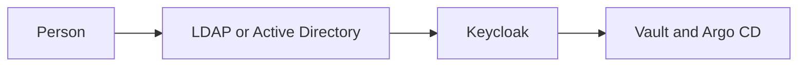
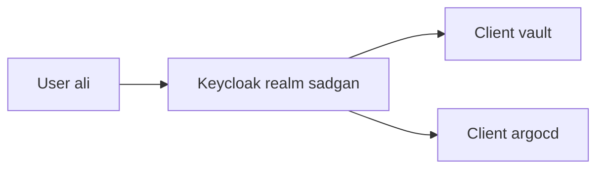
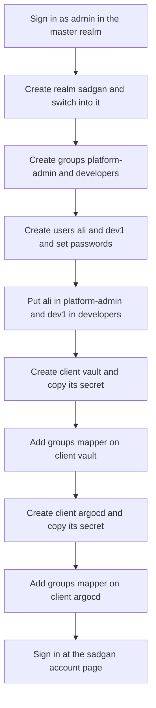
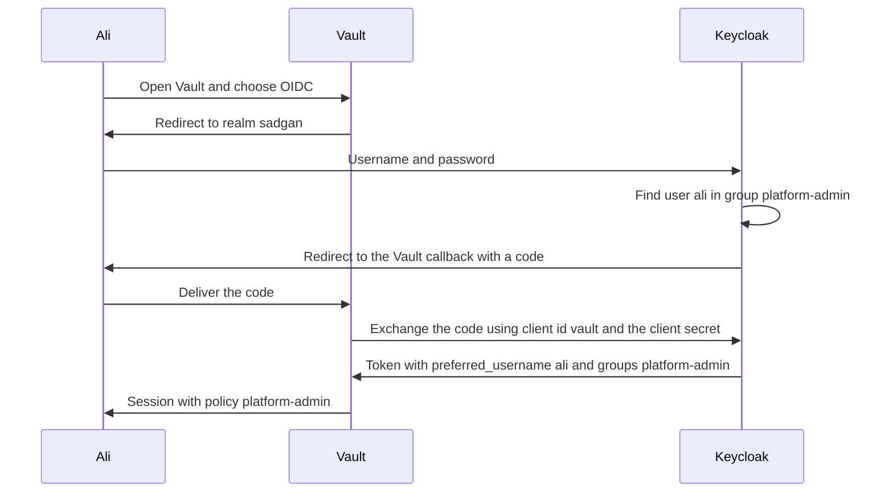

# Keycloak from zero

Keycloak is a login service you run yourself. A person types a password once at Keycloak. Keycloak then tells your other tools who that person is. Those tools do not keep their own password lists.

In this folder Keycloak is the front door. Vault is one of the tools behind that door. The Vault guide in `vault.md` connects the two. This guide builds the door.

## Words

| Word | Meaning |
|---|---|
| Realm | A separate user directory. Users in one realm cannot log in to another. |
| Master realm | Keycloak's own admin directory. You use it only to administer Keycloak. |
| User | A person who can log in. |
| Group | A label on a user, such as `platform-admin`. Other tools read this label and decide what the person may do. |
| Client | One application that trusts Keycloak. Vault is a client. Argo CD would be a second client. |
| Client secret | A password that belongs to the application, not to a person. Vault sends it to Keycloak when it checks a login. |
| Redirect URI | The exact address Keycloak may send the browser back to after login. |
| Token | A signed proof, valid for a few minutes, that says who logged in and which groups they are in. |
| OIDC | The protocol Keycloak speaks. Vault and Argo CD both understand it. |
| Issuer | Keycloak's public address for one realm. Vault downloads the login rules from this address. |

## LDAP or Keycloak

LDAP is a directory. It stores people, passwords, and groups, and it answers the question "does this username and password match a record?" Active Directory is the LDAP most companies already run. A mail server, a VPN, or a Linux server can ask that directory directly.

Keycloak is a login website in front of applications. It speaks OIDC, which is what Vault and Argo CD understand. The person sees one login page. Keycloak gives each application a token that says who the person is and which groups they are in.

| | LDAP | Keycloak |
|---|---|---|
| What it is | The address book of accounts | The login page applications redirect to |
| How an app connects | The app sends the username and password to the directory | The browser goes to Keycloak, and the app receives a token |
| Typical users of it | VPN, email, office PCs, older internal tools | Vault, Argo CD, Grafana, and other tools that expect OIDC |
| Groups | Yes, stored in the directory | Yes, and it can copy groups out of LDAP |

Use LDAP when the system already knows how to check a password against a company directory. Example: a staff laptop joins the domain, and the VPN accepts the same office username. Nothing in that path is a browser redirect or a token. Putting Keycloak in the middle does not help.

Use Keycloak when several web tools each need their own user list and you want one login instead. Example: `ali` opens Argo CD, signs in once, and Vault accepts that same login because both are clients of realm `sadgan`. Those products do not speak LDAP as their normal login. They speak OIDC.

Use both when the accounts already live in Active Directory and the new tools speak OIDC. Keycloak connects to LDAP as its user store. People keep their office passwords. Vault and Argo CD still talk only to Keycloak. You do not create `ali` by hand in Keycloak, and you do not teach Vault how to read LDAP.



This guide creates the users inside Keycloak so you can learn the pieces. A company directory replaces the "create a user" steps. The clients, redirect URIs, and group mapper stay the same.

## What this Compose file starts

`docker-compose.yml` starts three services:

- **Postgres** stores Keycloak's users and clients. If you delete this volume, the realm is gone.
- **Keycloak** is the login website.
- **Vault** is separate. Leave it alone until `vault.md`.

Keycloak inside the container always listens on port **8080**. The host port can be different. This line publishes host port 8888 into the container's 8080:

```yaml
ports:
  - "8888:8080"
```

Docker only forwards packets. Keycloak does not learn the host port from that line. The public address is `KC_HOSTNAME` in `.env`. If that value still says port 8080, the browser is sent to 8080 even though you opened 8888.

## 1. Start Keycloak

On the server, from `platform/identity`:

```bash
cp .env.example .env
```

Edit `.env`. Use the address you will type in a browser, including `http://` and the host port:

```bash
KC_DB_PASSWORD=a-long-random-password
KC_ADMIN_PASSWORD=a-different-long-password
KC_HOSTNAME=http://192.168.10.176:8888
VAULT_HOSTNAME=192.168.10.176
```

`192.168.10.176` is an example. Use the IP or DNS name of this server. The port in `KC_HOSTNAME` must be the port on the left of `ports:` (`8888`), not `8080`.

Start the stack:

```bash
docker compose up -d
docker compose ps
```

Postgres must become healthy before Keycloak starts. The first start can take a minute. Watch it with:

```bash
docker compose logs -f keycloak
```

Stop following logs with Ctrl+C. The containers keep running.

Open:

```text
http://192.168.10.176:8888
```

You should get Keycloak's welcome page, and the address bar should stay on port 8888. If it jumps to `:8080`, `KC_HOSTNAME` is wrong. Fix `.env`, then recreate only Keycloak:

```bash
docker compose up -d keycloak
```

## 2. Sign in as the Keycloak administrator

Open:

```text
http://192.168.10.176:8888/admin
```

| Field | Value |
|---|---|
| Username | `admin` |
| Password | the `KC_ADMIN_PASSWORD` from `.env` |

This account exists only to configure Keycloak. It is created on the first start. Changing `KC_ADMIN_PASSWORD` later does not change an admin that already exists.

You land in the **master** realm. The realm name is in the top left. Leave master for Keycloak administration. Application users go in a new realm so a Vault user is not a Keycloak administrator.

## 3. Create the company realm

1. Click the realm name **master** at the top left.
2. Click **Create realm**.
3. Realm name: `sadgan`.
4. Enabled: on.
5. Click **Create**.

The top left now says `sadgan`. Every following click in this guide happens in `sadgan`. If you are back in `master`, switch again.

## 4. Create groups

A group is how Vault will tell administrators from everyone else.

1. Left menu: **Groups**.
2. **Create group**.
3. Name: `platform-admin`.
4. Click **Create**.
5. Create a second group named `developers`.

`platform-admin` will be allowed to manage secrets. `developers` is there so you can see that a second group gets a smaller set of rights. Vault's guide attaches the actual permissions.

## 5. Create a user

1. Left menu: **Users**.
2. **Add user**.
3. Username: `ali`.
4. Email verified: on, if you type an email.
5. Click **Create**.

The user still has no password.

1. Open the user `ali`.
2. Tab **Credentials**.
3. **Set password**.
4. Type a password.
5. Temporary: **off**. If it stays on, the next login forces a password change and the Vault redirect often fails on the first try.
6. Save and confirm.

Put the user in the admin group:

1. Still on user `ali`, tab **Groups**.
2. **Join group**.
3. Select `platform-admin`.
4. Join.

Create a second user, for example `dev1`, with a password, and join only `developers`. You will use `dev1` later to prove that group membership changes what Vault allows.

## 6. Create the Vault client

A client is the registration that lets Vault send people to Keycloak.

1. Left menu: **Clients**.
2. **Create client**.
3. Client type: **OpenID Connect**.
4. Client ID: `vault`.
5. Name: `Vault`.
6. Click **Next**.

On the capability screen:

| Setting | Value | Why |
|---|---|---|
| Client authentication | On | Vault is a confidential client. It has its own secret. |
| Standard flow | On | This is the browser login. |
| Direct access grants | Off | That flow would let a script send a person's password. Leave it off. |

Click **Next**.

| Setting | Value |
|---|---|
| Root URL | `http://192.168.10.176:8200` |
| Valid redirect URIs | `http://192.168.10.176:8200/ui/vault/auth/oidc/oidc/callback` |
| Valid redirect URIs (second) | `http://127.0.0.1:8250/oidc/callback` |
| Web origins | `http://192.168.10.176:8200` |

The first redirect is the Vault website. The second is the Vault command-line login. Keycloak rejects the login if the address is not listed character for character. `localhost` and `127.0.0.1` are different. The port `8200` is Vault's published port.

Click **Save**.

### Copy the client secret

1. Open client `vault`.
2. Tab **Credentials**.
3. Copy **Client secret**.

You will paste it into Vault once. Store it next to the Vault root token, not in Git.

## 7. Put groups into the token

Vault does not read Keycloak's group screen directly. It reads a field named `groups` inside the login token. You add that field with a mapper.

1. Open client `vault`.
2. Tab **Client scopes**.
3. Open the scope that is the dedicated scope for this client. Its name looks like `vault-dedicated`.
4. Tab **Mappers**.
5. **Configure a new mapper**.
6. Choose **Group Membership**.

| Field | Value |
|---|---|
| Name | `groups` |
| Token Claim Name | `groups` |
| Full group path | **off** |
| Add to ID token | on |
| Add to access token | on |
| Add to userinfo | on |

Full group path must be off. Off sends `platform-admin`. On sends `/platform-admin`. Vault's group name has to match this text exactly.

Click **Save**.

## 8. Add Argo CD as a second client

Vault and Argo CD share the realm, the users, and the groups. They do not share a client. Each application has its own callback address, so each one is a separate client with its own secret. `ali` still has one password. After Keycloak knows `ali`, both Vault and Argo CD accept that same login.

Argo CD refuses an issuer that is plain `http://` unless the host is `localhost`. The Keycloak URL in this lab (`http://192.168.10.176:8888`) is enough for Vault. For Argo CD, publish Keycloak on HTTPS, for example `https://keycloak.sadgan.int`, and use that URL as `KC_HOSTNAME` and as the issuer below. The padlock can be your internal certificate. Argo CD must trust the certificate that signs it.

Replace `https://argocd.sadgan.int` in this section with the address you already use to open Argo CD.

### Create the client

In the `sadgan` realm:

1. Left menu: **Clients**.
2. **Create client**.
3. Client type: **OpenID Connect**.
4. Client ID: `argocd`.
5. Name: `Argo CD`.
6. Click **Next**.

| Setting | Value | Why |
|---|---|---|
| Client authentication | On | Argo CD sends a client secret, the same way Vault does. |
| Standard flow | On | This is the browser login. |
| Direct access grants | Off | Argo CD must not send a person's password. |

Click **Next**.

| Setting | Value |
|---|---|
| Root URL | `https://argocd.sadgan.int` |
| Valid redirect URIs | `https://argocd.sadgan.int/auth/callback` |
| Valid redirect URIs (second) | `http://localhost:8085/auth/callback` |
| Web origins | `https://argocd.sadgan.int` |

The first redirect is the Argo CD website. The second is `argocd login --sso` on your workstation. Keycloak rejects the login if either address differs by a letter, a port, or a trailing slash.

Click **Save**.

1. Open client `argocd`.
2. Tab **Credentials**.
3. Copy **Client secret**. Keep it with the Vault client secret. Do not commit it.

### Put groups into this token too

The Vault mapper does not apply to this client. Repeat it on `argocd`.

1. Open client `argocd`.
2. Tab **Client scopes**.
3. Open `argocd-dedicated`.
4. Tab **Mappers**, **Configure a new mapper**, **Group Membership**.

| Field | Value |
|---|---|
| Name | `groups` |
| Token Claim Name | `groups` |
| Full group path | **off** |
| Add to ID token | on |
| Add to access token | on |
| Add to userinfo | on |

Click **Save**. Off sends `platform-admin`. On sends `/platform-admin`, and Argo CD will not match the group.

### Tell Argo CD to trust Keycloak

Argo CD reads two ConfigMaps and one Secret in the `argocd` namespace. Patch the Secret that already exists. Replacing `argocd-secret` from scratch deletes the key Argo CD uses to sign its own sessions.

```bash
kubectl -n argocd patch secret argocd-secret --type merge \
  -p '{"stringData":{"oidc.keycloak.clientSecret":"<argocd-client-secret>"}}'
```

`url` in `argocd-cm` must be the same public address as the redirect URI, without `/auth/callback`.

```yaml
apiVersion: v1
kind: ConfigMap
metadata:
  name: argocd-cm
  namespace: argocd
data:
  url: https://argocd.sadgan.int
  oidc.config: |
    name: Keycloak
    issuer: https://keycloak.sadgan.int/realms/sadgan
    clientID: argocd
    clientSecret: $oidc.keycloak.clientSecret
    requestedScopes:
      - openid
      - profile
      - email
```

`clientSecret: $oidc.keycloak.clientSecret` tells Argo CD to read the key you patched into `argocd-secret`. The issuer is the realm address with no `/.well-known` suffix.

If Keycloak's certificate is signed by your private CA, paste that CA under `rootCA:` in the same `oidc.config` block. Argo CD then trusts the issuer. Skipping TLS verification is not the setup to keep.

Map the same Keycloak groups to Argo CD roles. This is Argo CD's copy of the Vault group-to-policy step. The names `platform-admin` and `developers` must match the token.

```yaml
apiVersion: v1
kind: ConfigMap
metadata:
  name: argocd-rbac-cm
  namespace: argocd
data:
  scopes: "[groups]"
  policy.default: ""
  policy.csv: |
    g, platform-admin, role:admin
    g, developers, role:readonly
```

`scopes: "[groups]"` means "read groups from the claim named `groups`". `role:admin` can sync and change applications. `role:readonly` can look only. An empty `policy.default` means a logged-in user who is in neither group has no Argo CD rights.

Reload the server:

```bash
kubectl -n argocd rollout restart deployment argocd-server
```

### Sign in

1. Open `https://argocd.sadgan.int` in a private window.
2. Choose **LOG IN VIA KEYCLOAK**.
3. Sign in as `ali`.

The browser goes to Keycloak and returns to `/auth/callback`. `ali` is an Argo CD admin because the token contains `platform-admin`. Sign out, then sign in as `dev1`. That user can open the UI and cannot sync applications.

From a workstation:

```bash
argocd login argocd.sadgan.int --sso
```

That command uses `http://localhost:8085/auth/callback`, which is already on the client.



One account and one group list sit in Keycloak. Vault turns `platform-admin` into a Vault policy. Argo CD turns that same group into `role:admin`. Disabling `ali` in Keycloak closes both logins.

## 9. Check that Keycloak is ready for Vault

From the server:

```bash
curl -fsS http://192.168.10.176:8888/realms/sadgan/.well-known/openid-configuration | head
```

A JSON document means the realm is published. Vault will download this same URL. The Vault container must be able to reach `192.168.10.176:8888`. On this Docker bridge it can, because that address is the host.

In a browser, private window:

1. Open `http://192.168.10.176:8888/realms/sadgan/account`.
2. Sign in as `ali`.

If that page opens, the person, the password, and the realm are valid. Vault's own login is configured in `vault.md`.

## 10. What each piece is for

You configure Keycloak once, in this order. Each box is one operation in the admin console. The later box cannot work if the earlier one was skipped.



| Step | What it produces | Who consumes it |
|---|---|---|
| Realm `sadgan` | A user directory separate from Keycloak's own admins | Vault's discovery URL ends in `/realms/sadgan` |
| Group | A name such as `platform-admin` | Vault matches this text to a policy |
| User | A person and a password | The person, at the Keycloak login page |
| Client `vault` | An application registration plus a client secret | Vault sends the secret when it checks the login |
| Client `argocd` | A second registration plus a different secret | Argo CD sends that secret when it checks the login |
| Redirect URI | The only address Keycloak may return the browser to | One URI for Vault, a different URI for Argo CD |
| Group mapper | A `groups` field inside the token | Vault reads `groups_claim`. Argo CD reads `scopes: "[groups]"` |

At login time the browser, Vault, and Keycloak do different jobs. Keycloak checks the password. Vault never sees that password. Vault only receives a token that names the person and the groups.



Keycloak answers "who is this person?" Vault answers "what may this group do?" Do not put Vault passwords into Keycloak. Do not put application secrets into Keycloak. Secrets belong in Vault.

## 11. After a reboot

`restart: unless-stopped` brings the containers back. Keycloak's users are in the Postgres volume, so the realm survives. You do not create `ali` again.

The admin password in `.env` is not reapplied. Forget the master-realm password and you reset it from the Keycloak container only with a recovery procedure. Keep `KC_ADMIN_PASSWORD` in a password manager.

## 12. Common failures

| What you see | Cause |
|---|---|
| Browser opens 8888 and lands on 8080 | `KC_HOSTNAME` does not include the published port. |
| Invalid redirect URI in Keycloak | The Vault callback is missing or uses `localhost` instead of the IP. |
| User must change password and Vault shows an error | Temporary was left on when you set the password. |
| Vault has no groups for the user | The group mapper is missing, or Full group path is on. |
| `curl` to the realm fails from inside Vault | The host IP is not reachable from the container. |
| Argo CD never shows **LOG IN VIA KEYCLOAK** | `oidc.config` is missing, or `argocd-server` was not reloaded after the ConfigMap change. |
| Argo CD reports the issuer is not HTTPS | Keycloak is still on `http://192.168.10.176:8888`. Argo CD requires an `https://` issuer. |
| Login succeeds and Argo CD says permission denied | The token group is `/platform-admin`, or `argocd-rbac-cm` scopes is not `[groups]`. |
| Invalid redirect URI on the Argo CD login | The client is missing `https://<argocd-host>/auth/callback`. |
